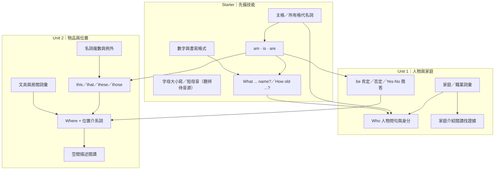
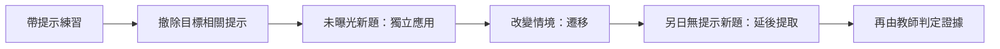

# Starter → Unit 2｜教學知識關聯（教師用可編輯圖）

此圖僅以已列入來源對照的內容表示學習依存關係。**不是固定教學順序，也不是學生已通過證據。** 題目、答案及正式 Source Lock 以題庫及目前 v2.4 Stable 為準。

## 兩條不能混淆的證據路徑

- `AUDIO_PENDING`：短母音、清濁音與複數字尾的真正聽辨，需音源與口語紀錄。
- Unit 1 的 `-er` 構詞屬 Extension，是否使用依已教狀態決定。
- 本圖刻意不加入課本尚未確認的外延知識點。